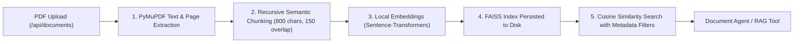

# Local RAG & Document Pipeline (`backend/app/rag/`)

## 1. Overview

The **Retrieval-Augmented Generation (RAG)** pipeline enables the research engine to ingest real PDF documents—such as annual reports, 10-K filings, earnings transcripts, and broker research notes—and ground agent analyses in verbatim disclosures.

The entire RAG system operates **locally and offline**:
- Uses **PyMuPDF** (`pymupdf`) for local PDF parsing.
- Uses **Sentence-Transformers** (`sentence-transformers`) for local embedding generation.
- Uses **FAISS** (`faiss-cpu`) for fast in-memory and on-disk vector similarity search.
- **₹0 / $0 Cost**: No third-party vector databases or paid embedding APIs required.



---

## 2. Ingestion Pipeline Steps

### 1. Document Extraction (`parser.py`)
- Reads uploaded PDF files using `fitz` (PyMuPDF).
- Retains structural metadata for every extracted block:
  - `page`: 1-indexed physical page number.
  - `section`: Detected section header or document division.
  - `document_id`: Unique identifier of the uploaded document.

### 2. Semantic Chunking (`chunker.py`)
- Splitting strategy: Recursive text splitting preserving paragraph and sentence boundaries.
- Target chunk size: **800 characters** with an overlap of **150 characters**.
- Each chunk preserves its exact bounding metadata (`document_id`, `company`, `period`, `page`).

### 3. Embeddings & Indexing (`retriever.py`)
- Employs lightweight, high-performance dense embeddings (e.g., `all-MiniLM-L6-v2`).
- Stores embeddings in a local FAISS `IndexFlatIP` (Inner Product on normalized vectors = Cosine Similarity).
- Serializes index and chunk metadata to `data/faiss/` for persistent lookup across server restarts.

---

## 3. Metadata-Filtered Retrieval

When agents invoke `search_documents`, they pass structured filters:

```python
docs = retriever.search(
    query="operating margin expansion",
    filters={
        "document_ids": ["doc_tcs_q3_fy24"],
        "company": "TCS",
        "doc_type": "quarterly_filing",
        "period": "Q3-FY24"
    },
    top_k=5
)
```

The retriever enforces exact metadata matching before scoring semantic similarity, ensuring that an agent researching Company A never retrieves chunks from Company B's uploaded reports.
