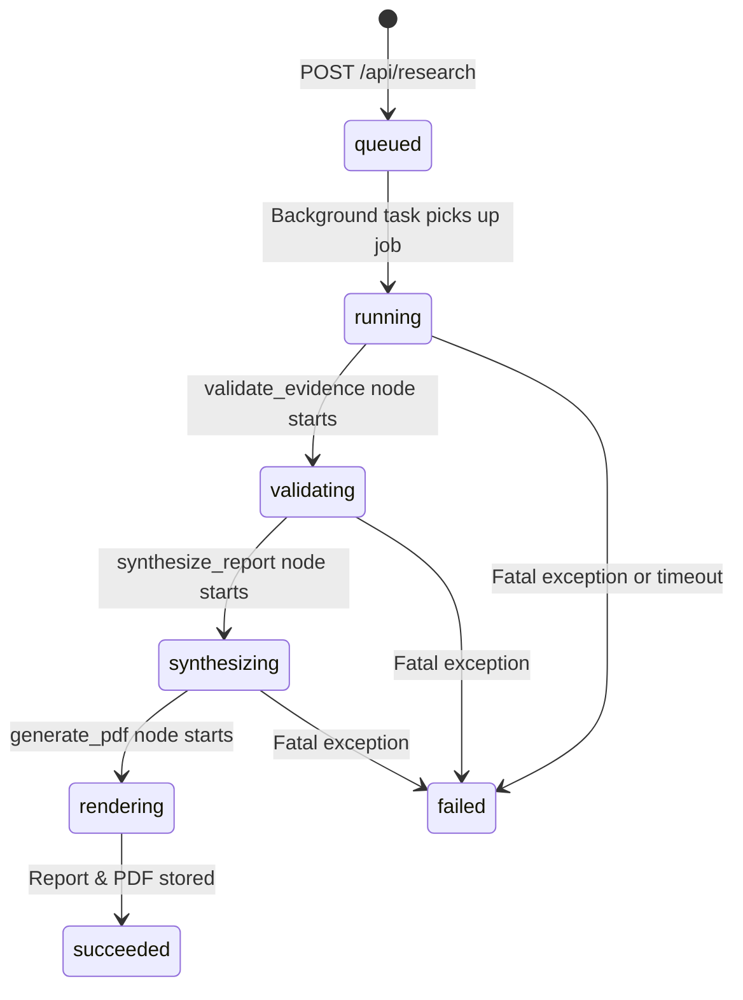

# Job Storage & State Persistence (`backend/app/storage/`)

## 1. Overview

The `storage/` package manages research job lifecycles, execution history, report caching, and grounded follow-up context.

### Technology: SQLite in WAL Mode
- Persistence engine: **SQLite3** with **Write-Ahead Logging (WAL)** enabled (`PRAGMA journal_mode=WAL;`).
- Zero external database services needed (no Docker, no PostgreSQL server required).
- High concurrent read performance: The React frontend can continuously poll `/api/research/{job_id}/status` while background worker threads write step updates without lock contention.

---

## 2. Job Lifecycle States

A research job progresses through distinct states:

- **`queued`**: Job created in SQLite, waiting for worker task.
- **`running`**: Specialist agents executing in parallel.
- **`validating`**: Evidence items undergoing fact-checking and conflict detection.
- **`synthesizing`**: Thesis challenger and report synthesis executing.
- **`rendering`**: Assembling `ReportJSON` and rendering PDF.
- **`succeeded`**: Terminal state. Report JSON and PDF available for download.
- **`failed`**: Terminal state. Detailed error information recorded in `job.errors`.

---

## 3. Stale Job Recovery (`fail_stale_jobs`)

If the FastAPI server crashes or reloads mid-run (e.g. during local development via `uvicorn --reload`):
- Any job left in `running`, `validating`, `synthesizing`, or `rendering` would otherwise stay "running" forever, causing the frontend UI to spin endlessly.
- On startup, `JobManager.fail_stale_jobs("interrupted by server restart")` scans the database and immediately marks orphaned jobs as `failed` with a clear explanation, allowing the user to retry cleanly.
