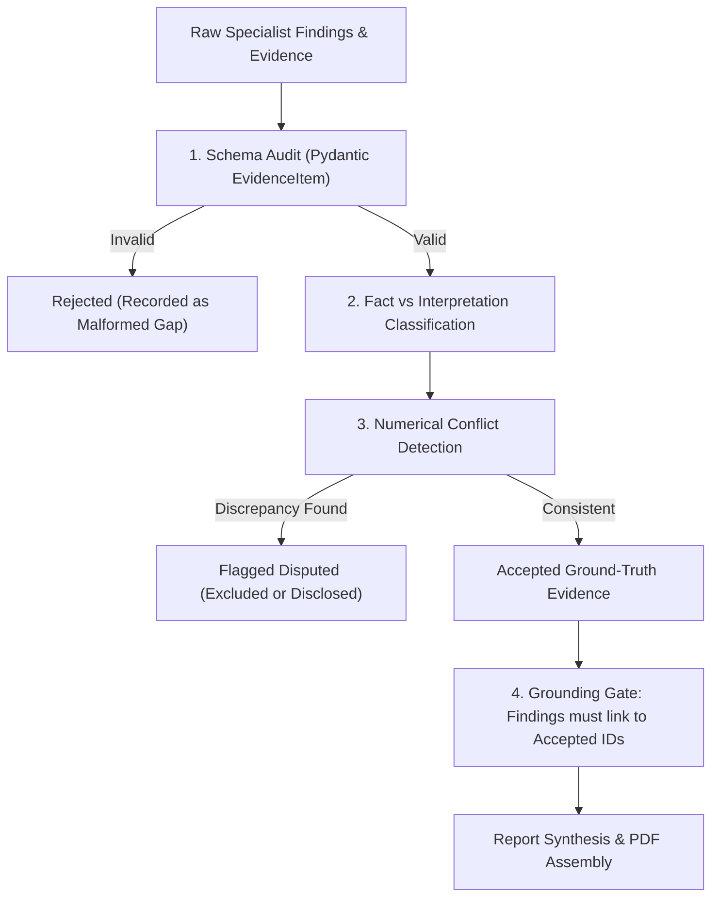

# Evidence Validation & Conflict Engine (`backend/app/validation/`)

## 1. Overview

In financial research, hallucinations and conflicting disclosures lead to catastrophic decisions. The **Validation Engine** serves as an institutional audit gate between the specialist agents and the final report synthesis.

No claim from any specialist is allowed into the final report unless it successfully passes validation.

---

## 2. Validation Stages

### Stage 1: Schema Integrity & Identifier Assignment
- Every evidence item must validate against the Pydantic `EvidenceItem` model.
- If a provider omitted a unique `evidence_id`, the system deterministically derives a stable SHA-1 hash from the claim text, source, page, and excerpt:
  `ev_sha1(agent|claim|source|url|date|excerpt)[:16]`
- Items with missing claims or invalid types are moved to `rejected_evidence` and logged in `evidence_gaps`.

### Stage 2: Fact vs Interpretation Separation
- **Fact**: Direct numerical measurements (e.g., *"Q3 Revenue was ₹60,583 Cr"*) or verifiable events (e.g., *"CFO resigned on Jan 15"*).
- **Interpretation**: Forward-looking statements, opinions, or qualitative conclusions (e.g., *"Margins appear well-protected"*).
- Numerical figures must have an associated numeric `value` and currency/unit (`unit`).

### Stage 3: Numerical Discrepancy & Conflict Detection
When multiple agents or tools collect figures for the same metric (e.g., FY24 Net Profit):
- The conflict detector extracts the numerical value, metric key, and company name.
- If two values differ by more than **5% tolerance** (e.g., Consolidated vs Standalone discrepancy):
  - A `ConflictItem` is generated.
  - The conflicting claims are flagged as disputed.
  - The dispute is highlighted in the final report's **Evidence Gaps & Disclosures** section rather than silently averaged out.

### Stage 4: Grounding Gate
Before synthesis:
- The engine checks every statement in `findings`, `positive_signals`, `negative_signals`, and `risks`.
- Every finding must explicitly reference an `evidence_id` in its `evidence_ids` array.
- Any finding that does **not** link back to an accepted evidence item is stripped out of the synthesis state, and an audit message is added:
  `"{agent}: unlinked finding excluded from synthesis"`

---

## 3. Evidence Gap Management

Evidence Gaps are first-class citizens in Artha-AI. When data is missing, we **never guess or infer**. We record an explicit `evidence_gap` stating:
1. What data was missing (e.g., *"Valuation: EV/EBITDA omitted because total debt was unavailable"*).
2. Which agent could not find it.
3. The impact on the investment thesis.
