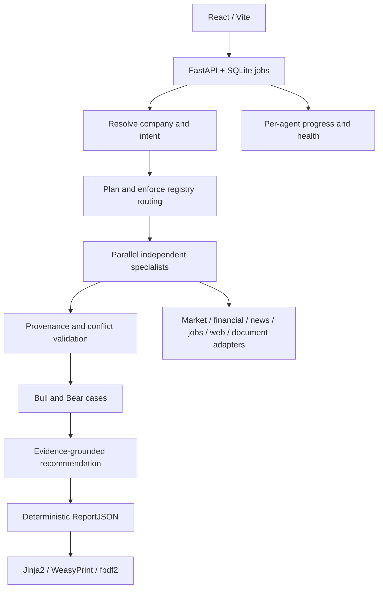

# Bullseye architecture

This document supersedes the obsolete CrewAI Flow specification. The audit found
no CrewAI runtime. LangGraph and LangChain are the selected existing framework.

## Contracts

- LLMs explain, Python computes. Calculations retain inputs, formula, basis and
  comparable periods. No invented peer benchmarks or universal quality scores.
- Evidence carries stable IDs, source, retrieval time and publication time where
  supplied. Retrieval time must never be presented as publication time.
- Original claim-link coverage is distinct from independent factual verification.
- Numerical conflicts compare the same metric/entity/period/basis/unit, not just
  identical sentence text. Unresolved evidence does not support a recommendation.
- Each specialist can fail independently. A completed empty search is unavailable
  evidence, not a green successful contribution.
- Broad company research covers every core domain. Focused queries retain the
  smallest relevant set; uploaded documents explicitly add document research.
- SQLite stores report and validated packet for grounded follow-ups. New data
  needs a new research run. Existing history is retained.
- Frontend progress comes from JobStatus. Product demonstrations are explicitly
  labelled and contain no invented stock measurements or recommendations.
- Missing LLM credentials leave data collection available. This deterministic
  mode is not an offline simulator. Tests mock every external data boundary.

## Preserved architecture decisions

Provider-agnostic gateway with retries; cached/coalesced read-only tools; parallel
work with isolated state; bounded document upload; local RAG/keyword fallback;
stale-job recovery; canonical citation index; cancellable non-overlapping polling;
in-app PDF and downloads. See HANDOFF_AUDIT for the pre-merge execution discrepancy
and CHANGELOG_HANDOFF_MERGE for the staged migration and verification.
