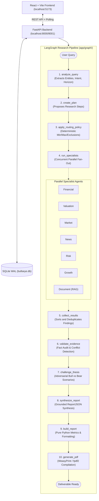

# Artha-AI: LangGraph State Machine Architecture

## 1. Executive Summary: Why LangGraph?

The research engine was originally conceived with CrewAI roleplay agents. However, for institutional equity research, autonomous roleplay introduced non-deterministic routing, brittle error handling, and frequent deprecation breaks.

We refactored the entire orchestration layer to **LangGraph**:
- **Pure State Machine (`StateGraph`)**: Replaced conversational agent chatter with explicit, testable, typed Python nodes and edges.
- **Deterministic Flow**: The flow from user query to query analysis, bounded research planning, parallel specialist fan-out, evidence validation, adversarial thesis challenge, and PDF synthesis is guaranteed and repeatable.
- **Complete Test Coverage**: 100% of all unit, regression, and end-to-end HTTP pipeline tests pass cleanly without external network or quota spend.
- **Zero Hallucination Arithmetic**: Maintained the core tenet: **"LLMs Reason, Python Computes"**.

---

## 2. High-Level System Architecture



---

## 3. Component-by-Component Guide

### 1. `backend/app/graph/` — The Orchestration Core
- **`state.py`**: The `ResearchState` TypedDict holding the entire context for the pipeline.
- **`nodes.py`**: The 10 discrete step functions that take state and return updates.
- **`builder.py`**: Assembles the LangGraph `StateGraph(ResearchState)` and compiles it.
- **`runner.py`**: Bridges FastAPI with LangGraph; streams node lifecycle events so the UI updates in real-time.
- **`specialists.py`**: Executes routed specialist agents in parallel with per-agent timeouts.
- **`routing.py`**: Enforces strict routing policies (caps concurrency at 6 agents, or 8 in comparison mode).
- **`meta.py`**: Structured Pydantic LLM gateways for extraction, planning, and thesis stress-testing.

### 2. `backend/app/agents/` — Domain Specialists
- Contains 9 dedicated specialists: Financial, Valuation, Market, News, Growth, Risk, Document, Industry, and Workforce.
- Every specialist produces a strictly typed `AgentResult` with claims linked to specific `EvidenceItem` records.
- Provides complete offline **₹0 mock mode** via `run_mock`.

### 3. `backend/app/tools/` — Deterministic Tools
- Enforces **"LLMs Reason, Python Computes"**.
- Financial ratio calculator (`calculate_ratio`) for P/E, P/B, EV/EBITDA, ROE, ROCE, PEG, debt/equity, and margins.
- Market data via `yfinance`, news headlines via Google RSS, and local ATS scrapers.
- All tools inherit from LangChain's `BaseTool` and return a standard `{ok, data, source, error}` envelope.

### 4. `backend/app/validation/` — Truth & Conflict Gate
- Rejects malformed evidence.
- Separates verified historical facts from qualitative forward-looking interpretations.
- Detects factual and numerical discrepancies across multiple data sources.
- Strips any finding that fails to link back to an accepted evidence ID.

### 5. `backend/app/rag/` — Local Vector Storage
- Local PDF parser using **PyMuPDF**.
- Local chunking and embeddings using **Sentence-Transformers**.
- Fast vector similarity search using **FAISS** (`faiss-cpu`) with metadata filtering.

### 6. `backend/app/report/` — Report & PDF Generation
- Assembles the complete `ReportJSON` object.
- Renders publication-grade PDFs using semantic Jinja2 HTML templates.
- Features automatic failover: Uses **WeasyPrint** when system GTK libraries are installed, and transparently falls back to pure-Python **`fpdf2`** on Windows systems without dependencies.

### 7. `backend/app/storage/` — SQLite Persistence
- Stores research history, job progress, and report context in `bullseye.db`.
- Uses SQLite **WAL mode** for high concurrency without database locking.
- Automatically recovers orphaned jobs on server restart (`fail_stale_jobs`).

---

## 4. How to Extend the System

### Adding a New Tool
1. Define a Pydantic schema in `backend/app/tools/<category>_tools.py`:
   ```python
   class MyToolArgs(BaseModel):
       symbol: str
   ```
2. Implement your Python function returning `{ "ok": True, "data": ..., "source": ... }`.
3. Wrap it in `NativeFunctionTool`:
   ```python
   my_tool = NativeFunctionTool(
       name="my_tool",
       description="Clear description for the agent.",
       args_schema=MyToolArgs,
       function=my_python_function,
   )
   ```
4. Attach `my_tool` to the relevant agent's `tools` list in `backend/app/agents/specialists.py`.

### Adding a New Specialist Agent
1. Subclass `BaseSpecialistAgent` in `backend/app/agents/specialists.py`.
2. Assign `name`, `tools`, `system_prompt`, and implement `run_mock`.
3. Register the agent in `AGENT_REGISTRY` and `backend/app/graph/routing.py`.
